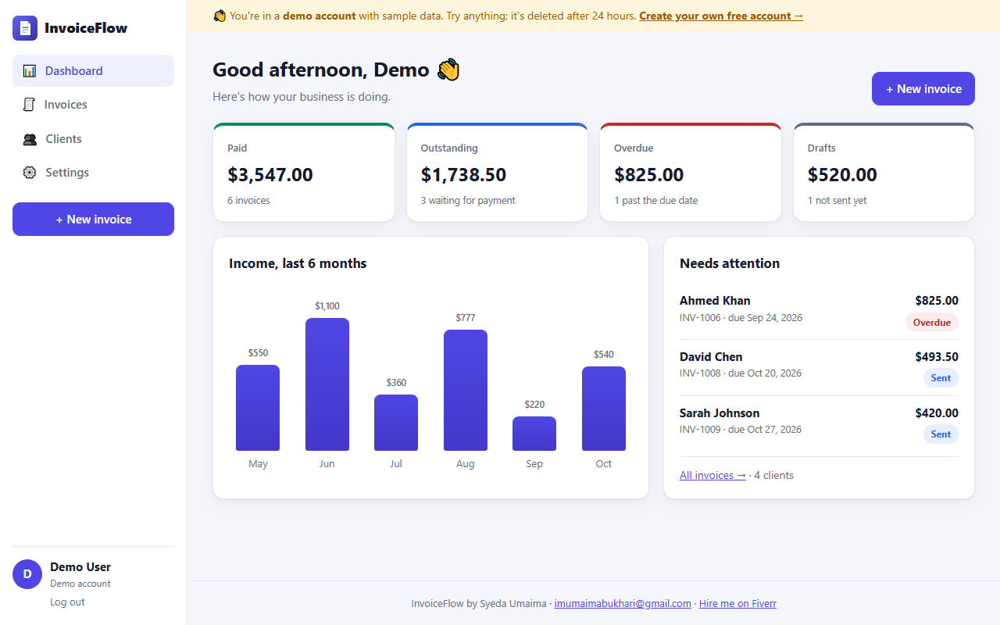
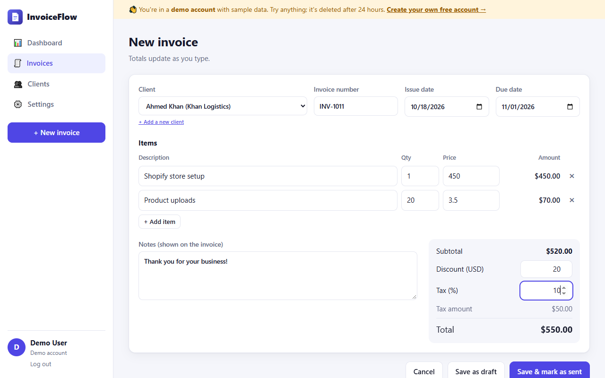
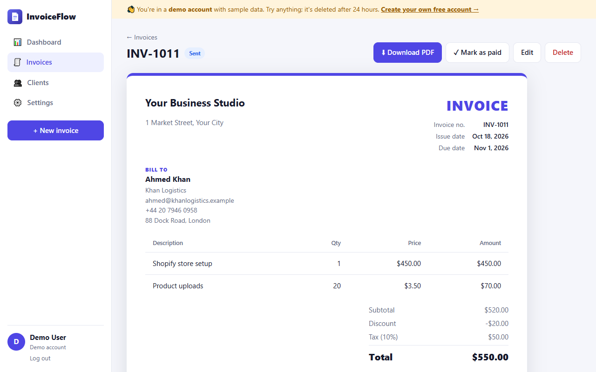
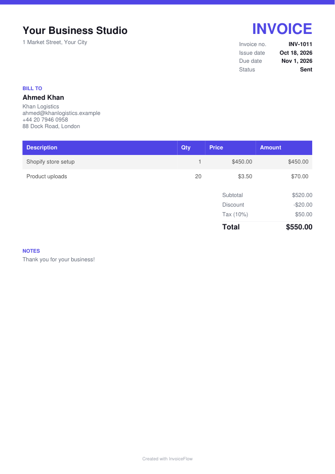

# 🧾 InvoiceFlow

A full-stack **MERN** app (MongoDB, Express, React, Node.js) for freelancers and small businesses: create professional invoices, track who has paid, manage clients, and see your income at a glance.

**Live demo:** _coming soon_ · Click **Try the demo** to open a private sample account, no sign-up needed.



## Features

- **Accounts:** sign up and log in with JWT tokens; passwords hashed with bcrypt; rate-limited login
- **One-click demo:** every visitor gets their own sample account (4 clients, 10 invoices), deleted automatically after 24 hours with a MongoDB TTL index
- **Invoices:** line items, tax %, discount, notes; totals update as you type and are recalculated on the server
- **Statuses:** Draft → Sent → Paid, and **Overdue** worked out automatically from the due date
- **PDF download:** a clean, professional invoice PDF generated in the browser (jsPDF, loaded only when needed)
- **Dashboard:** paid / outstanding / overdue / draft totals, income for the last 6 months, invoices that need attention
- **Clients:** add, edit and delete, with invoice count and total billed per client (a client with invoices can't be deleted by mistake)
- **Search and filters** on the invoice list; quick **Mark paid**
- **Settings:** business name, address and currency (USD, EUR, GBP, PKR, INR, AED, CAD, AUD)
- **Private by design:** every query is scoped to the logged-in user, so nobody can see anyone else's data
- Responsive (phone menu), light and dark mode

| New invoice | Invoice | PDF |
|---|---|---|
|  |  |  |

## Tech stack

| Part | Technology |
|---|---|
| Database | MongoDB (Atlas in production) + Mongoose |
| API | Node.js, Express 5, JWT, bcrypt, express-rate-limit |
| Front end | React 18, React Router, Vite |
| PDF | jsPDF + jspdf-autotable |
| Hosting | Vercel (static React build + Express as a serverless function) |

## Project structure

```
server/            Express API
  app.js           routes, error handling
  db.js            cached MongoDB connection (serverless-friendly)
  auth.js          JWT + requireAuth middleware
  demo.js          creates a sample account with clients and invoices
  models/          User, Client, Invoice (totals + overdue logic)
  routes/          auth, clients, invoices, dashboard
api/index.js       Vercel entry: exports the Express app
client/            React app (Vite)
  src/pages/       Landing, Login/Register, Dashboard, Invoices, InvoiceForm, InvoiceView, Clients, Settings
```

## Run it on your computer

You need Node.js 18+ and MongoDB (installed locally, or a free MongoDB Atlas cluster).

```bash
git clone https://github.com/imumaimabukhari-123/invoiceflow.git
cd invoiceflow
npm install
npm --prefix client install
copy .env.example .env      # on Mac/Linux: cp .env.example .env
```

Edit `.env` (set `MONGODB_URI` and a long random `JWT_SECRET`), then in two terminals:

```bash
npm run server     # API on http://127.0.0.1:5000/api
npm run client     # app on http://127.0.0.1:5173
```

## API

All routes except `/api/auth/*` need `Authorization: Bearer <token>`.

| Method | Route | What it does |
|---|---|---|
| POST | `/api/auth/register` · `/login` · `/demo` | Create account, log in, open a demo account |
| GET / PUT | `/api/auth/me` | Current user, update name and business details |
| GET / POST | `/api/clients` | List (with invoice stats) / create clients |
| PUT / DELETE | `/api/clients/:id` | Update / delete a client |
| GET / POST | `/api/invoices` | List / create invoices |
| GET | `/api/invoices/next-number` | Suggested next invoice number |
| GET / PUT / DELETE | `/api/invoices/:id` | Read / update / delete an invoice |
| PATCH | `/api/invoices/:id/status` | Change status (draft, sent, paid) |
| GET | `/api/dashboard` | Totals, counts, 6-month income, invoices needing attention |

## Need a web app like this?

I build full-stack MERN apps, dashboards, booking systems and AI tools.

**Syeda Umaima** · ✉️ [imumaimabukhari@gmail.com](mailto:imumaimabukhari@gmail.com) · [Hire me on Fiverr](https://www.fiverr.com/umaima886) · [GitHub](https://github.com/imumaimabukhari-123)
